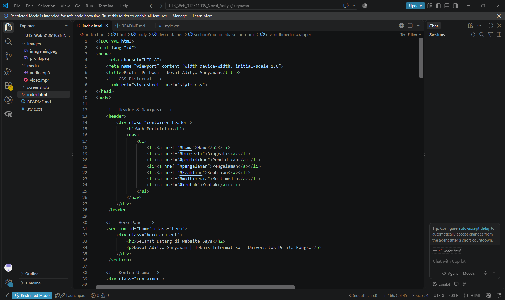
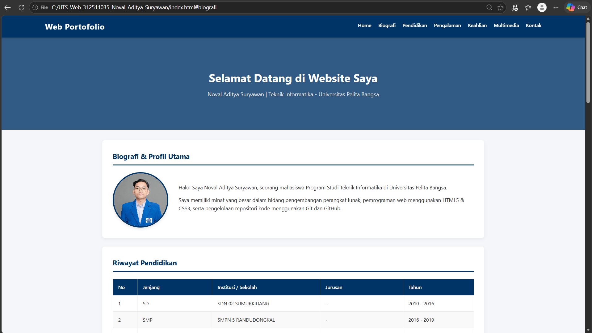
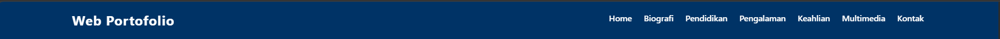
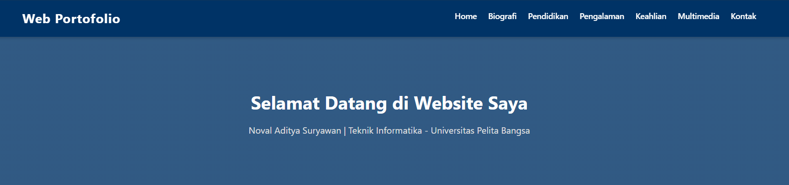
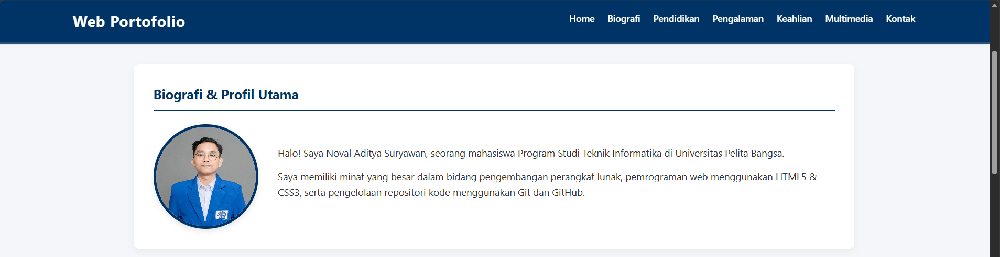
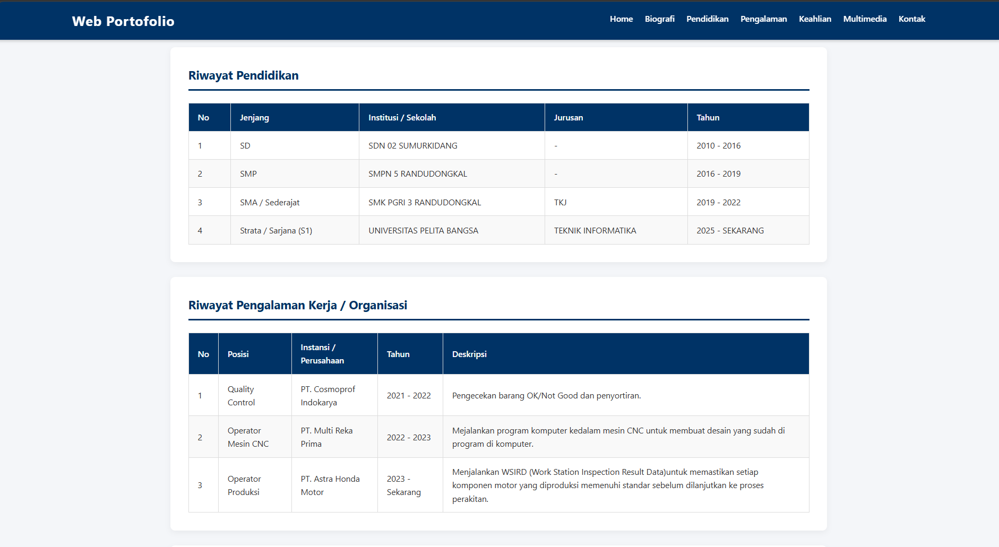

# 🌐 Web Portofolio - Ujian Tengah Semester (UTS) Pemrograman Web

Repositori ini berisi kode sumber dan dokumentasi proyek Ujian Tengah Semester (UTS) mata kuliah **Pemrograman Web** di **Universitas Pelita Bangsa**.

---

## 👨‍🎓 Informasi Mahasiswa

* **Nama:** Noval Aditya Suryawan
* **NIM:** 312510035
* **Program Studi:** Teknik Informatika (Kelas TI.25.C1 / I253B)
* **Mata Kuliah:** Pemrograman Web
* **Dosen Pengampu:** Sufajar Butsianto, S.Kom, M.Kom
* **Institusi:** Universitas Pelita Bangsa

---

## 📝 Deskripsi Proyek

Proyek ini dirancang untuk menampilkan profil diri secara profesional, mencakup riwayat pendidikan formal, pengalaman kerja di industri, daftar keahlian teknis, pemutar media perkenalan, serta formulir kontak interaktif.

---

## 🛠️ Spesifikasi & Fitur Website

Website ini mencakup seluruh komponen wajib sesuai dengan ketentuan soal UTS:
1. **Struktur Dokumen & Semantic HTML5:** Menggunakan tag semantik seperti `<header>`, `<nav>`, `<section>`, dan `<footer>`.
2. **Header, Navigasi, & Hero Panel:** Navigasi *sticky* di bagian atas serta *Hero Banner* perkenalan utama.
3. **Biografi & Profil Utama:** Menampilkan foto profil melingkar dengan deskripsi latar belakang.
4. **Tabel Riwayat Pendidikan:** Jenjang pendidikan dari tingkat dasar (SD) hingga perguruan tinggi (S1 Teknik Informatika).
5. **Tabel Riwayat Pengalaman Kerja:** Pengalaman industri di PT. Cosmoprof Indokarya, PT. Multi Reka Prima, dan PT. Astra Honda Motor.
6. **Riwayat Keahlian:** Penerapan *Unordered List* (`<ul>`) untuk keahlian teknis dan *Ordered List* (`<ol>`) untuk perangkat/tools.
7. **Elemen Multimedia:** Integrasi pemutar audio (`<audio>`) dan video (`<video>`) interaktif untuk perkenalan.
8. **Form Kontak Interaktif:** Formulir pesan yang dilengkapi validasi atribut HTML5 (`required`, `type="email"`).
9. **Styling & Layout CSS3:** Memanfaatkan *Flexbox*, *Media Queries* untuk tampilan responsif, serta efek *hover* interaktif.

---

## 📁 Struktur Folder Proyek

```text
UTS Web 312510035 Noval Aditya Suryawan/
├── index.html           # Halaman utama profil pribadi
├── style.css            # File stylesheet eksternal
├── images/              # Folder penampung foto & gambar latar
│   ├── profil.jpg       # Foto profil utama
│   └── imagelain.jpg    # Gambar latar belakang Hero panel
├── media/               # Folder penampung media perkenalan
│   ├── audio.mp3        # File audio perkenalan
│   └── video.mp4        # File video presentasi profil
└── README.md            # Dokumentasi / Laporan proyek

🖥️ Tangkapan Layar (Screenshot) Hasil Tampilan

(Tambahkan tangkapan layar tampilan halaman website Anda di sini)
Tampilan Program

Tampilan Web



Header

Hero Panel

Biografi

Tabel

💻 Cara Menjalankan Proyek

Unduh atau extract folder proyek UTS Web NIM Nama.

Buka folder proyek menggunakan browser (Google Chrome, Mozilla Firefox, Microsoft Edge, dll.).

Klik dua kali pada file index.html atau drag-and-drop file index.html ke dalam browser.

Diverifikasi oleh: Ketua Program Studi Teknik Informatika — Dr. Ir. Ananto Tri Sasongko., M.Sc.